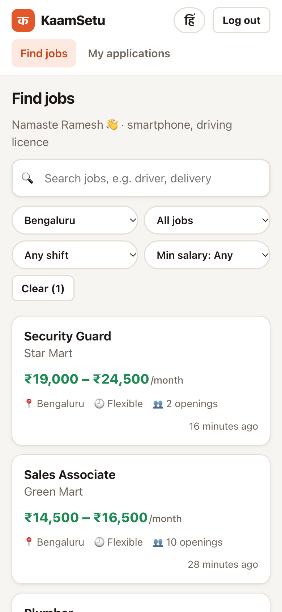
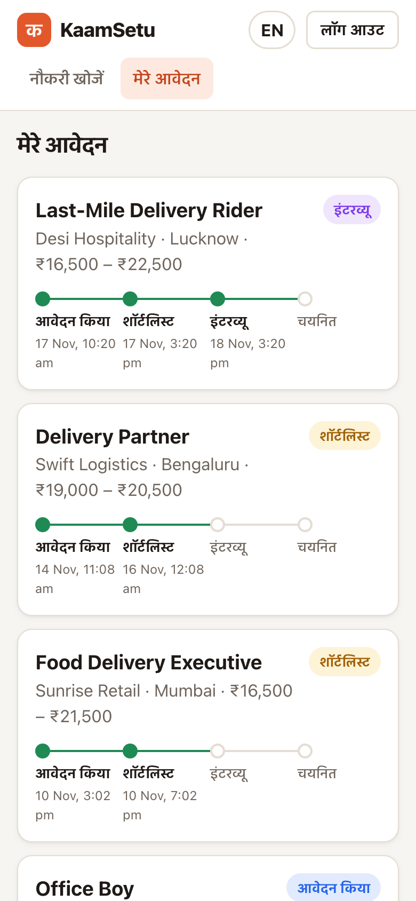
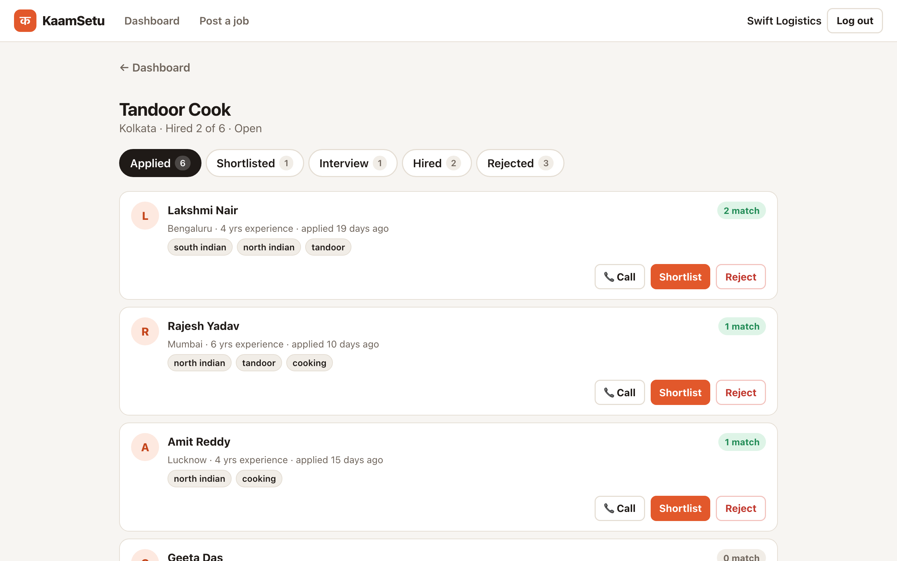

# KaamSetu

[](https://github.com/kashish-awasthi/kaamsetu/actions/workflows/ci.yml)


**A job marketplace for blue-collar workers.** Workers find nearby jobs and apply in one tap, in English or Hindi. Employers post jobs, see applicants ranked by skill match, and move them through a hiring pipeline.

*KaamSetu* (काम सेतु) means "bridge to work".

**[▶ Live demo](https://kaamsetu-jobs.vercel.app)**: tap *Worker demo* or *Employer demo* on the login page. Data is seeded (50,000 jobs).


<p>
  
  
</p>



## What it does

**Workers** (mobile-first)
- Search 50,000 jobs with prefix search ("deliv" finds "Delivery Partner"), and filter by city, job type, shift and minimum salary. Filters live in the URL, so a search can be shared over WhatsApp.
- See how many of a job's required skills they have, apply in one tap, and track every application on a timeline (applied → shortlisted → interview → hired).
- Switch the whole worker interface between English and Hindi.

**Employers**
- Post jobs, open or close them, and see each job's pipeline counts on a dashboard.
- Review applicants ranked by skill match and experience; shortlist, interview, hire or reject, or call them directly.
- Hiring the last opening closes the job automatically.

## Engineering highlights

### PostgreSQL schema, constraints and indexes
- **The database enforces the rules**: enums for roles, shifts and statuses; `CHECK` constraints (valid Indian mobile numbers, `salary_max >= salary_min`); foreign keys with cascades; and `UNIQUE (job_id, worker_id)`, so a worker can never apply twice, even with concurrent requests.
- **Audit trail**: every status change is written to `application_events` with who made it and when, which powers the worker's timeline.
- **Full-text search** via a generated `tsvector` column (title weighted above description) with a GIN index.
- **Partial composite indexes** on `(city | category, created_at DESC, id DESC) WHERE is_open`, matching exactly how the feed is queried.

Measured on the seeded data (50,000 jobs, best of 7 runs):

| Query | Without index | With index |
|---|---|---|
| Open jobs in one city, newest first | 5.48 ms (sequential scan) | **0.04 ms** (index-only scan, 0 heap fetches) |
| Prefix search "forklift" | 5.00 ms | **0.27 ms** (GIN) |
| Page 150 of the feed | 0.19 ms with `OFFSET` | **0.04 ms** with keyset cursor |

### Keyset pagination
The feed pages with an opaque cursor over `(created_at, id)` instead of `OFFSET`, so every page costs the same however deep you scroll, and new jobs arriving mid-scroll don't cause duplicates or skipped rows. The front end loads the next page automatically with `IntersectionObserver` and `useInfiniteQuery`.

### Concurrency-safe hiring
Status changes run in a single transaction that locks the application and its job (`SELECT … FOR UPDATE OF a, j`), checks the move against a state machine, counts hires, and closes the job when the last opening is filled. Two recruiters hiring for the last opening at the same moment get one success and one clear `409`, and this is proven by a test that fires both requests in parallel.

### Node.js API
- Express 5 (async errors handled natively), Zod validation with field-level messages, JWT auth with worker and employer roles, bcrypt, Helmet, and rate-limited login.
- A `withTransaction` helper that always commits or rolls back and releases the connection; independent dashboard queries run in parallel with `Promise.all`.
- Postgres errors become friendly HTTP responses (duplicate phone → `409`, unknown category → `400`), and other companies' data returns `404` rather than `403`, so ids can't be probed.

### React front end
- React 19, TypeScript (strict), React Router and TanStack Query.
- **State**: server state in TanStack Query; auth and language in Context with custom hooks (`useAuth`, `useT`); filters in the URL; `useDebouncedValue` for search.
- **Optimistic updates**: moving an applicant updates the UI instantly and rolls back if the server refuses (for example, openings already filled).
- **Built for the users**: phone-number login, large tap targets, Indian salary formatting (₹1,20,000), one-tap calling for employers, and accessible forms with labelled errors.

### Tests
**32 tests**, all run in CI against a real PostgreSQL service:
- **API (19, Vitest + Supertest on a real database):** validation, auth and roles, filters, search, cursor paging with no gaps or duplicates, 10 simultaneous duplicate applications (exactly one succeeds), the race for the last opening, the pipeline state machine, cross-company isolation, and skill-match ranking.
- **Web (13, Vitest + React Testing Library):** components in English and Hindi, pipeline actions, the skills input, the debounce hook, and API client error handling.

## Project structure

```
server/
  db/migrations/001_init.sql   Schema, constraints, indexes, categories
  db/migrate.ts                Forward-only migration runner
  db/seed.ts                   Reproducible seed: 50k jobs, 3k workers, 20k applications
  src/app.ts                   Express app (helmet, JSON, routes, error handler)
  src/db.ts                    Pool, query and withTransaction helpers
  src/routes/                  auth, jobs (feed, search, apply), me, employer (pipeline)
  test/                        API tests against a real Postgres database
web/
  src/hooks/queries.ts         TanStack Query hooks, incl. optimistic pipeline moves
  src/lib/                     API client, auth and i18n contexts, formatting
  src/pages/                   Worker and employer screens
```

## Run it locally

You need Node.js 22+ and PostgreSQL 16.

```bash
npm install
createdb kaamsetu && createdb kaamsetu_test
npm run db:setup     # migrate + seed (about 3 seconds)
npm run dev          # API on :4000, web app on http://localhost:5180
npm test             # API tests use the kaamsetu_test database
```

Demo logins (password `demo1234`): worker **9000000001**, employer **9000000002**. The login page has one-tap buttons for both.

## Deployment

The React build and the Express API deploy together on Vercel: `api/index.js` exports the same Express app as a serverless function, and `vercel.json` routes `/api/*` to it and everything else to the React app. The database is Neon (serverless PostgreSQL, Singapore region), migrated and seeded with the same scripts used locally.

## What I'd add next
- OTP login by SMS instead of passwords
- Distance-based search with PostGIS ("jobs within 5 km")
- Notifications to workers when their application status changes
- Voice search in Hindi for workers who prefer speaking to typing
